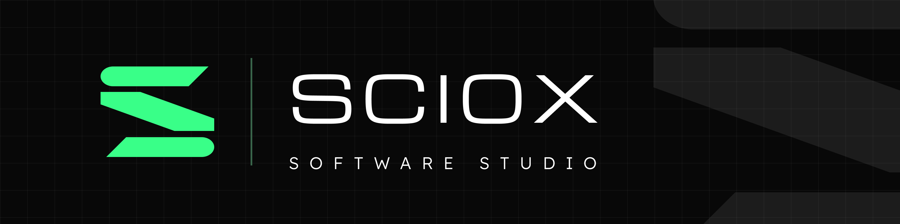

   

  

  <i>We turn ideas into powerful digital products.</i>

---

<h2 align="center">⚡ What We Do</h2>

<table align="center">
  <tr>
    <td align="center" width="200">💻 <b>Custom Software</b> Tailored solutions for your business</td>
    <td align="center" width="200">🌐 <b>Web Development</b> Modern, fast and responsive sites</td>
    <td align="center" width="200">📱 <b>Mobile Apps</b> iOS and Android applications</td>
  </tr>
  <tr>
    <td align="center" width="200">🎮 <b>Game Development</b> Fun and engaging mobile games</td>
    <td align="center" width="200">📊 <b>Data Science</b> Turn data into smart decisions</td>
    <td align="center" width="200">🤖 <b>AI Solutions</b> Intelligent features for your products</td>
  </tr>
</table>

---

<h2 align="center">🛠️ Tech Stack</h2>

<b>Frontend</b>

  
  
  
  

<b>Backend & Cloud</b>

  
  
  
  
  
  

<b>Mobile & Games</b>

  
  
  
  

<b>Data Science & AI</b>

  
  
  

---

<h2 align="center">📬 Contact</h2>

  
  

  

  
